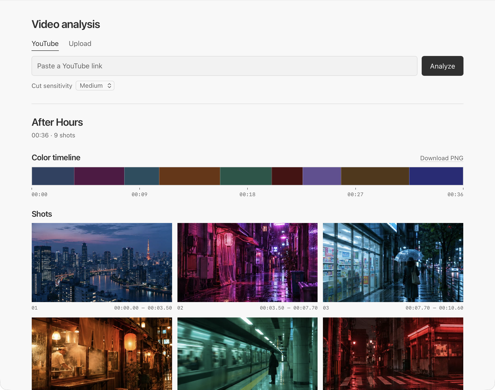
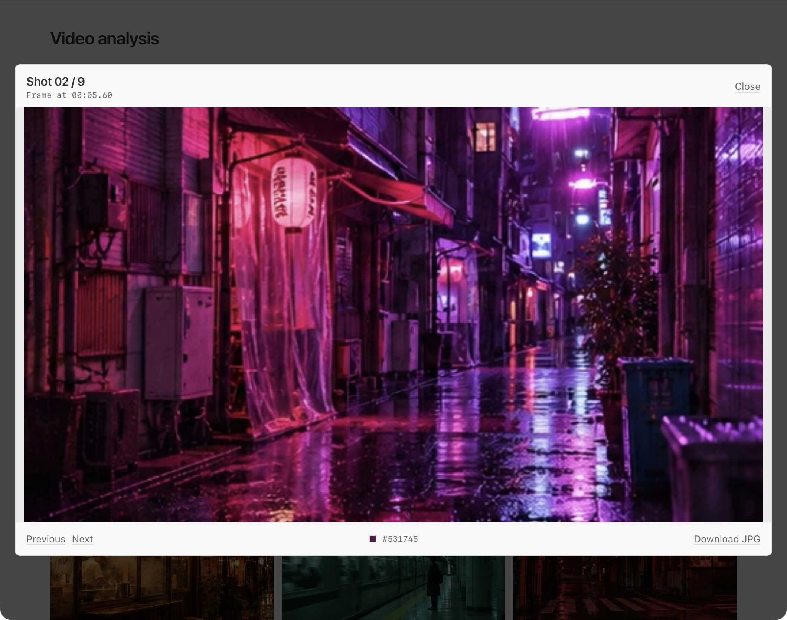

# Video analysis

Turn a video into a color timeline and a gallery of shots. Paste a YouTube link or upload a file, then click any color segment or thumbnail to open its screenshot. The app runs in your browser and processes videos on your computer.



<details>
<summary>View the shot lightbox</summary>



</details>

## Install and run

You'll need **Python 3.9+** and **FFmpeg 5.1+** with both `ffmpeg` and `ffprobe` on your PATH. The app itself uses Python's standard library.

On macOS with Homebrew, install FFmpeg with `brew install ffmpeg`. On Linux, use your distribution's FFmpeg package or install a recent build. [FFmpeg downloads](https://ffmpeg.org/download.html)

```sh
git clone https://github.com/DannyRuchtie/video-analysis.git
cd video-analysis
python3 server.py
```

Open [Video analysis](http://127.0.0.1:8765/). The **YouTube** tab opens first. Use **Upload** for a local video. Click **Analyze** and open a shot from the timeline or gallery. Use the arrow keys to browse inside the lightbox and Escape to close it. The color strip is available as a PNG and individual frames as JPEGs.

The server listens on your computer's loopback address. It saves results under `.shotline/results/` and removes its temporary copy of each imported video after processing. Use `--port` to choose a different local port.

### YouTube imports

Install [yt-dlp](https://github.com/yt-dlp/yt-dlp/wiki/Installation) with its EJS scripts and either Deno or Node.js 22 or newer. The app finds `yt-dlp` on your PATH. On macOS, `brew install yt-dlp` installs the downloader and its Deno dependency. With pipx, install the bundled scripts using `pipx install 'yt-dlp[default]'` and install the JavaScript runtime separately. [YouTube setup in yt-dlp](https://github.com/yt-dlp/yt-dlp/wiki/EJS)

Use YouTube links for videos you have permission to download. To load the optional *Paperman* example, start the server with `python3 server.py --paperman`. The app caches that analysis on your computer.

## Command-line scripts

```sh
python3 scene_screenshots.py "/path/to/video.mp4" -o screenshots
python3 color_timeline.py "/path/to/video.mp4" -o palette
```

| Script | Output |
| --- | --- |
| `scene_screenshots.py` | One JPEG near the middle of each shot and a `shots.json` file with timestamps |
| `color_timeline.py` | A duration-weighted `color-strip.png` and a `colors.json` file with shot times and RGB and hex values |

Choose a new output directory for each run. Use `--threshold` to tune cut detection and `--min-shot` to set the minimum gap between cuts. The detector checks surrounding frames to reduce false splits from fast movement and brief obstructions. Gradual transitions can still be missed. Each color averages the full frame across the shot and weights frames by their time on screen.

The README shows *After Hours*, a nine-shot example assembled from generated stills.
